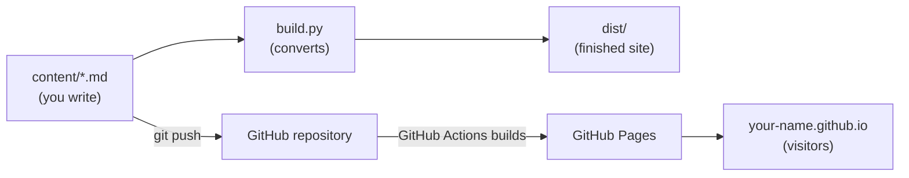
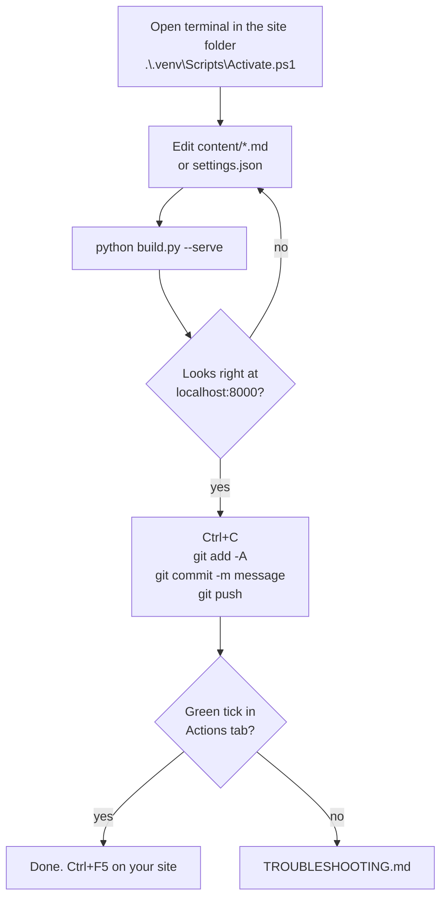

# ABC guide: your own website from zero

For someone who has never used git or Python.
Every step is written out. Commands are for **PowerShell on Windows**.
macOS and Linux differences are marked **Mac/Linux**.

Time needed the first time: about one hour.

---

## Part 0. The big picture

1. You write pages as plain text files (`.md`, Markdown) in the folder `content`.
2. A small program, `build.py`, turns them into a finished website in the folder `dist`.
3. **git** keeps a history of your files and sends them to **GitHub**.
4. **GitHub Pages** shows the website to the world, for free.
5. "Publishing" means sending your changes to GitHub. GitHub builds and publishes the site for you.



### Words you will meet

| Word                | Meaning                                                                 |
| ------------------- | ----------------------------------------------------------------------- |
| terminal, PowerShell | A window where you type commands instead of clicking                  |
| folder path         | The address of a folder, for example `C:\Users\you\Documents\site`      |
| Python              | A programming language. `build.py` is written in it                     |
| package             | A ready-made add-on for Python. This site needs two: Markdown and PyYAML |
| virtual environment, venv | A private box of Python packages for one project, folder `.venv`  |
| git                 | A program that saves versions of your files                             |
| repository, repo    | A folder that git tracks. A copy also lives on GitHub                   |
| commit              | One saved version, with a short message                                 |
| push                | Send your commits from your computer to GitHub                          |
| clone               | Download a repository from GitHub to your computer                      |
| GitHub Actions      | A robot on GitHub that runs commands every time you push               |
| Markdown            | Plain text with simple marks: `#` heading, `-` list, `**bold**`         |
| front matter        | The lines between two `---` at the top of a page file                   |

---

## Part 1. Install the tools (once per computer)

### 1.1 Python

1. Go to https://www.python.org/downloads/ and download the latest Python 3.
2. Run the installer.
3. **Tick "Add python.exe to PATH"** on the first screen. Without it, the `python` command is not found.
4. Click **Install Now**.

**Mac/Linux:** macOS: install from python.org. Linux: Python is usually installed. The command is `python3` instead of `python`.

### 1.2 Git

1. Go to https://git-scm.com/downloads and download Git for your system.
2. Run the installer. The default answers are fine. Click **Next** until **Install**.

### 1.3 A text editor (recommended)

Visual Studio Code, https://code.visualstudio.com/. It has a built-in terminal: menu **Terminal**, **New Terminal**.
Notepad also works, but it does not colour Markdown.

### 1.4 Check that it worked

Close all terminal windows. Open a new PowerShell: press the Windows key, type `PowerShell`, press Enter.

```powershell
python --version
git --version
```

Each line should print a version number, for example `Python 3.13.1` and `git version 2.47.0`.
If not, see [TROUBLESHOOTING.md](TROUBLESHOOTING.md), section 1.

### 1.5 Tell git who you are (once)

GitHub can hide your real e-mail address. Use the hidden one:

1. Create a free account at https://github.com if you have none.
2. On GitHub: your picture, top right, **Settings**, **Emails**.
3. Tick **Keep my email addresses private**. GitHub shows an address like `12345678+yourname@users.noreply.github.com`. Copy it.

```powershell
git config --global user.name "yourname"
git config --global user.email "12345678+yourname@users.noreply.github.com"
```

---

## Part 2. Get your own copy

### 2.1 Make the repository on GitHub

1. Open this frame's page on GitHub.
2. Click the green **Use this template** button, then **Create a new repository**.
   If you see no such button, click **Fork** instead.
3. **Repository name:** `yourname.github.io`, with your own GitHub user name.
   This name gives the address `https://yourname.github.io`.
   Any other name gives `https://yourname.github.io/repo-name/`.
4. **Public.** Free GitHub Pages works only from public repositories.
5. Click **Create repository**.

### 2.2 Download it to your computer

Pick where the site will live, for example your Documents folder.

```powershell
cd $HOME\Documents
git clone https://github.com/yourname/yourname.github.io.git
cd yourname.github.io
```

`cd` means "go into this folder". You are now inside your site folder.
Every later command in this guide is run from here.

**Mac/Linux:** `cd ~/Documents` instead of `cd $HOME\Documents`.

---

## Part 3. Prepare Python for this project (once per folder)

```powershell
python -m venv .venv
.\.venv\Scripts\Activate.ps1
pip install -r requirements.txt
```

What happens:

1. `python -m venv .venv` creates a private package box in the folder `.venv`.
2. `Activate.ps1` switches it on. The prompt now starts with `(.venv)`.
3. `pip install` downloads the two packages into the box.

**Mac/Linux:** `python3 -m venv .venv`, then `source .venv/bin/activate`.

**Error "running scripts is disabled on this system":** see [TROUBLESHOOTING.md](TROUBLESHOOTING.md), section 2.

**Every time** you open a new terminal for this site, switch the box on again:

```powershell
cd $HOME\Documents\yourname.github.io
.\.venv\Scripts\Activate.ps1
```

If you forget, you will see `No module named 'markdown'`.

---

## Part 4. Build and look at the site

```powershell
python build.py --serve
```

1. The terminal prints `wrote 10 pages` and `serving on http://localhost:8000`.
2. Open http://localhost:8000 in your browser. This is your site, running only on your computer.
3. Click around. Try FIN/ENG at the top left. Make the browser window narrow to see the mobile menu.
4. Stop the preview with **Ctrl+C** in the terminal.

You can also open `dist\index.html` by double-clicking it.

---

## Part 5. Make it yours

### 5.1 Site name and contact details

Open `settings.json` in your editor. Change:

- `title`: your name, per language
- `tagline`: one line under the name
- `email`: your public contact address, or `""` for none
- `contact_links`: LinkedIn, GitHub and so on. Delete lines you do not need

**Commas matter.** Every item in a list ends with `,` except the last one.
A missing or extra comma stops the build. `build.py` then prints the line number.

### 5.2 Edit a page

1. Open `content\index.en.md`.
2. Leave the lines between `---` and `---` in place. Change the text after them.
3. Save. Run `python build.py --serve` again and reload the browser with **Ctrl+F5**.

Markdown in one table:

| You type                    | You get              |
| --------------------------- | -------------------- |
| `# Title`                   | Big heading          |
| `## Section`                | Smaller heading      |
| `- item`                    | Bullet list          |
| `1. item`                   | Numbered list        |
| `**bold**`                  | **bold**             |
| `[text](https://site.com)`  | A link               |
| `` | A picture |

### 5.3 Add a new page

Example: a page called `blog`.

1. Copy `content\example-project.en.md` to `content\blog.en.md`. Copy the `.fi.md` file the same way.
2. Change `title` and the text in both files.
3. In `settings.json`, inside `"nav": [ ... ]`, add:

```json
{
  "slug": "blog",
  "visible": true,
  "title": { "en": "Blog", "fi": "Blogi" }
},
```

4. `slug` must match the file name: `blog` for `blog.en.md`. Lowercase, no spaces.
5. Build and check.

### 5.4 Pictures and files

- Pictures: copy `.png` or `.jpg` into `assets\img`. Use them as `/assets/img/name.png`.
- Downloads such as PDFs: copy into `assets\files`. Link them as `/assets/files/name.pdf`.
- Keep pictures small. Under 300 KB each loads fast on a phone.

### 5.5 Hide or remove a page

- Hide: `"visible": false` in `settings.json`. Bring it back with `true`.
- Remove for good: delete its two `.md` files and its entry in `settings.json`.

---

## Part 6. Publish

### 6.1 Turn on GitHub Pages (once)

1. Open your repository on github.com.
2. **Settings** tab (top row of the repository, not your account settings).
3. Left menu: **Pages**.
4. **Source:** choose **GitHub Actions**.

### 6.2 Send your changes

```powershell
git add -A
git commit -m "First version of my site"
git push
```

1. `git add -A` picks up every changed file.
2. `git commit -m "..."` saves a version with your message.
3. `git push` sends it to GitHub.

The first push opens a browser window asking you to sign in to GitHub. Sign in once. Git remembers it.

### 6.3 Watch it go live

1. On github.com, open your repository, tab **Actions**.
2. A run appears. A yellow dot means running. A green tick means published. A red cross means it failed: click it and read the red step, then see [TROUBLESHOOTING.md](TROUBLESHOOTING.md), section 6.
3. Open `https://yourname.github.io`. The first time can take up to 10 minutes. Press **Ctrl+F5** to skip the browser's memory.

Your own domain name, for example `yourname.com`: [CUSTOM_DOMAIN.md](CUSTOM_DOMAIN.md).

---

## Part 7. The everyday loop



Working on two computers? Run `git pull` first, before you edit. It fetches the latest version from GitHub.

---

## Part 8. Five rules

1. Everything in the repository is public. Never put passwords, tokens, keys, phone numbers or private notes in it.
2. Never edit files in `dist` by hand. The next build overwrites them. `dist` is not sent to GitHub.
3. Do not move or rename the `.venv` folder. If you move the site folder, delete `.venv` and redo Part 3.
4. Do not use `git push --force` unless you know exactly what it replaces. It deletes history on GitHub.
5. Build and look before you push.

## Where next

- Something broke: [TROUBLESHOOTING.md](TROUBLESHOOTING.md)
- Own domain name: [CUSTOM_DOMAIN.md](CUSTOM_DOMAIN.md)
- Keep the source private: [TWO_REPO_DEPLOY.md](TWO_REPO_DEPLOY.md)
- How `build.py` works: [TECHNICAL.md](TECHNICAL.md)
