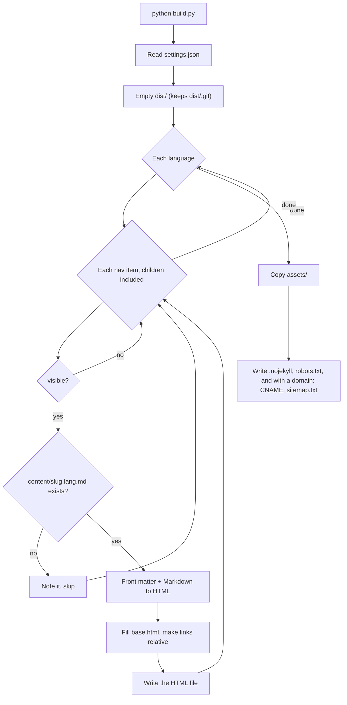

# Technical notes

For people who want to change `build.py` or the template.

## Design choices

| Choice | Reason | Trade-off |
| ------ | ------ | --------- |
| One Python file, no framework | Readable end to end. No dependency tree that ages on its own | Past a few dozen pages, or for a blog archive with pagination, a ready generator (Eleventy, Hugo, Astro) becomes the better tool |
| Zero JavaScript | Fast load, nothing to track visitors, less to maintain | The mobile menu cannot close itself after a click |
| `str.replace` templating | No template language to learn | No loops or conditions in `base.html`. Logic lives in `build.py` |
| Relative links in output | `dist/index.html` works from disk and under a sub-path | Content files must use root-relative links (`/x.html`) for the rewrite to work |
| Self-hosted font | No request to third parties | You ship the font license with the files |

## How a build runs

A missing translation does not stop the build.

## URL scheme

Default language at the root, others under `/<lang>/`. Slugs are the same in every language,
so the language switch is the same path with another prefix.

| Page | Default language (`en`) | Other (`fi`) |
| ---- | ----------------------- | ------------ |
| Home | `/index.html` | `/fi/index.html` |
| About | `/about.html` | `/fi/about.html` |

## settings.json fields

| Field | Type | Meaning |
| ----- | ---- | ------- |
| `site.domain` | text, may be `""` | Custom domain. Empty: no `CNAME`, no sitemap |
| `site.title`, `site.tagline` | text or `{lang: text}` | Header lines |
| `site.default_lang` | text | Language at the site root |
| `site.languages` | list | Order of the language switch. Each needs a `UI` block in `build.py` |
| `site.email` | text, may be `""` | Footer mail link |
| `site.contact_links` | list of `{label, href}` | Footer links |
| `nav[].slug` | text | File name stem and URL |
| `nav[].visible` | true/false | Build and show the page |
| `nav[].footer_only` | true/false | Footer link instead of menu item |
| `nav[].title` | `{lang: text}` | Menu label |
| `nav[].children` | list | Sub-pages, same fields |

## Template placeholders

`base.html` uses `{{name}}`. Available names:
`lang`, `root`, `page_title`, `site_title`, `site_tagline`, `description`, `home_url`,
`lang_switch`, `tree`, `content`, `meta`, `contact`, `footer_links`, `build_date`,
`nav_label`, `menu_label`, `meta_label`, `updated_label`, `lang_label`.

An unknown placeholder stays in the output as text. Search `dist` for `{{` after editing the template.

## Security notes

1. The site takes no visitor input. No forms, no server code.
2. A public repository shows its full history. Deleting a file does not remove it from past commits.
3. Option A workflow permissions: `contents: read`, `pages: write`, `id-token: write`. Option B: `contents: read` plus one deploy key.
4. Workflows use actions by version tag (`@v4`). Pinning to a commit hash is stricter. Dependabot can keep either up to date.

## Known gaps

- No unit tests for `build.py`.
- No Content Security Policy header. GitHub Pages cannot set headers; a `<meta http-equiv>` tag is the only route.
- Images are not resized or optimised by the build.
